# vix

Vic's machines, homes and dev envs in [sven](https://github.com/vic/sven): a real-world sven fleet.
9 NixOS hosts, 2 macs, 2 standalone homes, 6 dev envs and 5 neovim profiles, from one tree of plain Nix files.
Every table and diagram below is computed from the fleet when this file is written.

Generated file: edit `modules/docs/`, then run `nix run .#write-files`.

## A tour of sven, in vix

sven has four words: kinds, scopes, aspects, sinks. Each row links to the line in vix that uses a construct.

| sven | in vix |
| --- | --- |
| `sven.kinds.<k>`: typed data | [`host`](modules/platforms/nixos.nix#L73), [`guest`](modules/platforms/microvm.nix#L41), [`mac`](modules/platforms/darwin.nix#L4), [`home`](modules/platforms/home-manager.nix#L28), [`user`](modules/topology/people.nix#L23), [`env`](modules/envs/env.nix#L31), [`vim`](modules/editors/vim.nix#L23) |
| fields and types | [`a ref field`](modules/topology/machine.nix#L38), [`opt (a default)`](modules/topology/machine.nix#L39), [`maybe (null)`](modules/topology/machine.nix#L47), [`listOf, attrsOf, enum`](modules/helpers.nix#L11), [`is (any check)`](modules/topology/ssh-hosts.nix#L7), [`shared fields`](modules/platforms/nixos.nix#L74) |
| `derive`: a default computed from the instance | [`checkout: from kind and users`](modules/vic/dots.nix#L18), [`a system's runner: from the machines on it`](modules/flake/ci.nix#L43) |
| `sven.<k>.<name>`: an instance | [`sven.host.frodo`](modules/hosts/frodo/default.nix#L4), [`sven.home.bitstream`](modules/hosts/home-bitstream.nix#L4), [`sven.user.vic`](modules/topology/people.nix#L38), [`sven.env.rustenv`](modules/envs/envs.nix#L5), [`sven.vim.neovim`](modules/vic/nvf/profiles.nix#L3) |
| data kinds: instances no `spawns` reaches | [`channel`](modules/topology/channel.nix#L17), [`secret`](modules/topology/secrets.nix#L27), [`a secret only tools read`](modules/topology/secrets.nix#L19), [`ssh-host`](modules/topology/ssh-hosts.nix#L35), [`emacs`](modules/editors/emacs.nix#L14), [`workspace`](modules/topology/workspaces.nix#L9) |
| `spawns`: the scope tree | [`fleet → system, host, mac, home`](modules/topology/fleet.nix#L13), [`host → user`](modules/platforms/nixos.nix#L75), [`host → guest`](modules/platforms/microvm.nix#L39), [`system → vim`](modules/editors/vim.nix#L22), [`user → env`](modules/envs/env.nix#L21) |
| `sven.aspects.<a>`: one feature | [`git`](modules/vic/vcs/git.nix#L5), [`kvm-amd`](modules/hardware/kvm.nix#L4), [`hostname`](modules/topology/machine.nix#L65) |
| `at`: where an aspect is active | [`an instance`](modules/hosts/frodo/impermanence.nix#L16), [`a kind`](modules/flake/ci.nix#L67), [`an aspect`](modules/vic/vcs/git.nix#L6), [`a list: any`](modules/roles/roles.nix#L19), [`from many files: a union`](modules/hosts/frodo/default.nix#L20), [`nowhere`](modules/vic/rdesk.nix#L5) |
| roles from data: a fact test, no host file names them | [`ci-runner: a ghRunner label`](modules/hosts/ci-runner.nix#L7), [`installer: form iso`](modules/roles/roles.nix#L29), [`wsl: form wsl`](modules/forms/wsl.nix#L7), [`autoinclude: a hosts/<name>/_nixos dir`](modules/hosts/autoinclude.nix#L12) |
| `all`, `not`, `within`, `has`, `same`, fact tests | [`all [ vic-headless (not (within installer)) ]`](modules/roles/tiers.nix#L14), [`has guest`](modules/platforms/microvm.nix#L117), [`s: s.cpu == "amd"`](modules/hardware/kvm.nix#L7), [`same g.on h`](modules/platforms/microvm.nix#L11) |
| sinks and their reduce | [`merge`](modules/topology/fleet.nix#L19), [`set`](modules/platforms/accounts.nix#L15), [`list (the default)`](modules/platforms/nixos.nix#L77), [`one: one formatter per system`](modules/flake/outputs.nix#L32), [`one: one admin per mac`](modules/platforms/accounts.nix#L18), [`entries: each value with its giver`](modules/platforms/ports.nix#L8), [`own reduce: flat (unique concat)`](modules/helpers.nix#L42), [`own reduce: persist (path union)`](modules/platforms/impermanence.nix#L11) |
| typed sinks: `of` checks each element | [`a list of secret refs`](modules/topology/secrets.nix#L37), [`a dots path that exists`](modules/vic/dots.nix#L27), [`{ port; what; }`](modules/platforms/ports.nix#L9) |
| forwards: a sink key names another sink | [`os → nixos`](modules/platforms/nixos.nix#L138), [`guest nixos → host nixos`](modules/platforms/microvm.nix#L50), [`account → os`](modules/platforms/nixos.nix#L144), [`homeManager → os`](modules/platforms/home-manager.nix#L56), [`persist → nixos`](modules/platforms/impermanence.nix#L26), [`host secrets → nixos (sops-nix)`](modules/topology/secrets.nix#L40), [`env-packages → homeManager`](modules/envs/env.nix#L42), [`nvf → packages`](modules/editors/vim.nix#L31), [`user unfree → machine unfree`](modules/nix/unfree.nix#L18) |
| `out`: flake outputs | [`nixosConfigurations.<host>`](modules/platforms/nixos.nix#L125), [`ci.matrix`](modules/flake/outputs.nix#L16), [`rdfPack`](modules/agent/rdf.nix#L12), [`sven.flake`](modules/topology/fleet.nix#L22) |
| the `out` arg: an element reads the flake outputs, not `inputs.self` | [`vic-edge wraps out.packages`](modules/packages/vic-edge.nix#L7), [`ci.yml from out.checks and out.ci.matrix`](modules/flake/ci-workflow.nix#L128) |
| a sink `at`: who may receive | [`homeLinux on linux`](modules/platforms/home-manager.nix#L77), [`account on machines`](modules/platforms/nixos.nix#L143) |
| walls: a sink with no keys keeps elements at its scope | [`git-ignores`](modules/topology/people.nix#L33), [`nix-features`](modules/nix/features.nix#L12), [`ports (to served)`](modules/platforms/ports.nix#L18) |
| args: a kind, a sink, `scope` | [`{ host, ... }`](modules/flake/ci.nix#L62), [`{ env, env-packages, ... }`](modules/envs/env.nix#L42), [`{ scope, ... }`](modules/topology/machine.nix#L67), [`{ primary-user, ... }`](modules/forms/wsl.nix#L16) |
| errors as data: an `errors` key gives error records, no throw | [`a secret file no instance owns`](modules/topology/secrets.nix#L52), [`a proxyJump cycle`](modules/topology/ssh-hosts.nix#L82), [`0 or 2+ runners on a system`](modules/flake/ci.nix#L47), [`frodo wipeRoot guards`](modules/hosts/frodo/impermanence.nix#L47), [``one` with two admins`](modules/platforms/accounts.nix#L54) |
| `sven.helpers`: shared values | [`helpers`](modules/helpers.nix#L7), [`place`](modules/helpers.nix#L24), [`sopsSecrets`](modules/helpers.nix#L50) |
| flake-file: inputs per aspect | [`vix-flake`](modules/flake/flake-file.nix#L31), [`env-rust`](modules/envs/rust.nix#L6) |
| files: generated repo files | [`the files sink`](modules/flake/files.nix#L8), [`this README`](modules/docs/readme.nix#L78), [`ci.yml`](modules/flake/ci-workflow.nix#L130) |
| graphs (`sven.lib.graphs`) | [`sccs: ssh jumps`](modules/topology/ssh-hosts.nix#L85), [`transpose, nodesOf: flake follows`](modules/agent/invariants.nix#L123) |
| invariants: Datalog over the facts | [`invariants`](modules/agent/invariants.nix#L40), [`runners-no-users`](modules/agent/invariants.nix#L58), [`unique-port`](modules/agent/invariants.nix#L87), [`follows-declared`](modules/agent/invariants.nix#L116) |
| stored queries and krn synthesis | [`stored queries`](modules/agent/queries.nix#L34), [`portsOf`](modules/agent/queries.nix#L69), [`unfreeOn`](modules/agent/queries.nix#L51), [`freePort: a krn finite domain`](modules/agent/synthesis.nix#L13), [`a `ports` element`](modules/vic/ai/headroom.nix#L34) |
| trust labels and the knowledge pack | [`labels by path`](modules/agent/labels.nix#L4), [`rdf share (sha256)`](modules/agent/rdf.nix#L13), [`SHACL shapes`](modules/agent/rdf.nix#L20) |
| stage and change programs | [`a change program`](modules/docs/_readme-recipes.nix#L7), [`stage a change`](mcp/test.sh#L34), [`dry-run a program`](mcp/test.sh#L61), [`the MCP app`](modules/agent/mcp.nix#L5) |
| tests.nix: oracles over the eval result | [`file order: reversed modules, same values`](tests.nix#L65), [`laziness: a broken mac never reaches frodo`](tests.nix#L83), [`negative controls`](tests.nix#L108), [`e2e: settings fingerprint vs vix`](tests.nix#L51) |

## How vix uses sven

Each row is one sven capability: what it is, and the vix configuration it carries. The links point at the line.

| Capability | What it is | How vix uses it | Where |
| --- | --- | --- | --- |
| Typed fields | Each field of a kind has a type. A wrong value is an error record with `near`. | Machine facts are enums: `cpu`, `gpu`, `form`, `desktops`, `layouts`. Hardware aspects key on them. | [`desktops`](modules/topology/machine.nix#L56) |
| Derived fields (`derive`) | A field default that the instance computes from itself. An explicit value wins. | `checkout` for every machine with users. `cpu` and `gpu` from the facter report. The CI runner label of each system. | [`checkout`](modules/vic/dots.nix#L18), [`cpu from facter`](modules/topology/machine.nix#L42), [`runner`](modules/flake/ci.nix#L43) |
| Data kinds | A kind that no kind spawns. Its instances have no scope; refs to them work. | Secrets, ssh hosts, workspaces and channels are data that aspects read. | [`secret`](modules/topology/secrets.nix#L27), [`workspace`](modules/topology/workspaces.nix#L9) |
| Structure from data (`spawns`) | A scope's children come from a function of the data. | Each workspace becomes a microvm guest on frodo. Home nargun lives under host nargun. | [`guests from workspaces`](modules/topology/workspaces.nix#L18), [`home on host`](modules/platforms/home-manager.nix#L50) |
| Walls | A sink with no keys. Elements stop there and go no higher. | A home under a host walls every host sink, so vic's home never changes nargun's NixOS. | [`home walls`](modules/platforms/home-manager.nix#L38) |
| Aspects and predicates (`at`) | An aspect is active where its `at` holds: kinds, instances, aspect refs, `all`, `not`, `within`, `has`. | The tiers (`vic-headless`, `vic-gui`, `vic-full`, `vic-secrets`) gate every feature of vic. | [`tiers`](modules/roles/tiers.nix#L8) |
| Roles from data | An aspect whose `at` is a fact about the instance. | A machine with a `ghRunner` label is a CI runner: one aspect for bill, tom and bert. | [`ci-runner`](modules/hosts/ci-runner.nix#L7) |
| Own reduce | A sink reduce is any function of `[ { from; value; } ]`. | claude settings are ranked layers (rank 1 wins per key). List sinks keep first-seen order (`flat`). Permissions are sorted. | [`layers`](modules/vic/ai/claude.nix#L21), [`flat`](modules/helpers.nix#L42), [`sorted`](modules/topology/people.nix#L11) |
| `one` reduce | Exactly one element, or an error record. | The primary user of a mac and the WSL default user. Two admins are an error, not a silent pick. | [`primary-user`](modules/platforms/accounts.nix#L18), [`wsl`](modules/forms/wsl.nix#L14) |
| `entries` reduce | Each value comes with the scope that gave it. | Ports go up to the fleet `served` sink with their scope. The vini tunnel forwards what runs on bitstream. | [`served`](modules/platforms/ports.nix#L22), [`tunnel forwards`](modules/vic/sys/ssh.nix#L29) |
| Forwards | A sink key feeds another sink, at the receiver. | A user's ports feed the fleet. A guest's NixOS goes into its host's `microvm.vms`. | [`ports to served`](modules/platforms/ports.nix#L19), [`guest to host`](modules/platforms/microvm.nix#L53) |
| The cycle form | A component that asks the tree for data and gives 0 to n elements. | The microvm host asks for its guest scopes and gives one network setup for them. | [`vm-host`](modules/platforms/microvm.nix#L126) |
| The `out` arg | An element reads the flake outputs lazily. | Release images, the CI workflow and the claude MCP entry read built outputs, not `inputs.self`. | [`release images`](modules/packages/release-images.nix#L9), [`sven-mcp in claude`](modules/agent/mcp.nix#L44) |
| Errors as data | An aspect key `errors` gives error records. Evaluation continues. | frodo's wipeRoot guards, secret files that no instance owns, CI runner labels, sharedPkgs groups. | [`secret-files`](modules/topology/secrets.nix#L52), [`runner labels`](modules/flake/ci.nix#L47), [`shared pkgs`](modules/platforms/nixos.nix#L59) |
| Autoinclude | Files found by path become modules: no line in the host file. | `hosts/<name>/_nixos` holds each machine's hardware, disko and facter report. | [`autoinclude`](modules/hosts/autoinclude.nix#L12) |
| Exports | A scope outside any machine sends its content to a flake output. | `homeModules.vic`: vic's headless home for other flakes. | [`homeModules.vic`](modules/platforms/exports.nix#L14) |
| Flake inputs per aspect | Each aspect declares the inputs it uses. `flake.nix` is generated. | microvm, disko, impermanence, sops-nix and the skill inputs live with their users. | [`microvm input`](modules/platforms/microvm.nix#L71) |
| Generated files | The `files` sink writes files and checks that they are current. | README.md and the CI workflow. | [`ci.yml`](modules/flake/ci-workflow.nix#L1) |
| Invariants | Datalog rules over the fleet's facts. A true `bad:` atom is a violation. | Guest addresses and service ports are unique, every `follows` names a declared input, runners have no users. | [`unique-guest-addr`](modules/agent/invariants.nix#L76), [`follows-declared`](modules/agent/invariants.nix#L116) |
| Stored queries and krn | A named question on the eval result. krn synthesizes values that meet constraints. | `portsOf` a machine, and `freePort` picks a port that no service of the host uses. | [`portsOf`](modules/agent/queries.nix#L69), [`freePort`](modules/agent/synthesis.nix#L2) |
| Graphs | Reachability, cycles and layers over successor maps. | The ssh proxyJump graph: a jump cycle is an error. | [`ssh jumps`](modules/topology/ssh-hosts.nix#L85) |
| Trust labels | Content gets the trust of the files that declare it. | Files that agents write get a lower trust, so their routed elements are easy to list. | [`labels`](modules/agent/labels.nix#L4) |
| Knowledge pack | The eval result as N-Triples with a sha256, and SHACL shapes. | `out.rdfPack` for quipu, one snapshot per revision. | [`rdfPack`](modules/agent/rdf.nix#L12) |
| Infra checks | Facts from fleet data, compared with each built system. | Hostname, keyd, nvidia, enthium and persisted directories, per host. | [`infra`](modules/checks/infra.nix#L44) |
| Eval cost levers | Shared pkgs per channel and system; a trimmed NixOS module list. | Ready for every host, off on all: enabling them needs the drvPath oracles on each host. | [`sharedPkgs`](modules/platforms/nixos.nix#L39), [`docs off`](modules/platforms/nixos.nix#L45) |
| MCP server | Agents ask the fleet over stdio JSON-RPC. | vic's claude sessions have the `sven` MCP server for this fleet. | [`claude entry`](modules/agent/mcp.nix#L34) |
| CI gate | One eval per PR: no error records, invariants ok, no undefined aspect. | The `sven-gate` job of the generated workflow. | [`sven-gate`](modules/flake/ci-workflow.nix#L108) |
| Tests | Checks over the eval result itself. | File order changes no result; a broken varda never stops frodo. | [`file order`](tests.nix#L65) |

## Commands

```sh
nix build .#nixosConfigurations.annatar.config.system.build.toplevel
nix build '.#homeConfigurations."vic@bitstream".activationPackage'
nix run .#write-files                                # regenerate this README and ci.yml
nix build .#write-flake && ./result/bin/write-flake  # regenerate flake.nix from the flake-file sink
nix flake check                                      # includes checks.x86_64-linux."files/README.md"
nix eval --json .#ci.matrix                          # every CI build job: host, mac, home, devshell
nix eval --impure --json --file query.nix check.violations   # invariants: [ ] when all hold
nix eval --impure --json --file query.nix agent.counts       # scopes, edges, aspects, kinds
nix eval --impure --json --expr '(import ./query.nix).ask "aspectsOn" { name = "annatar"; }'
nix eval --impure --json --expr '(import ./query.nix).ask "freePort" { name = "annatar"; }'
nix eval --offline --impure --file tests.nix failed      # oracles: errors, check.ok, file order, laziness ([ ] when all hold)
nix eval --offline --impure --file tests.nix e2e.failed  # each machine's and home's settings fingerprint vs vix
nix run .#sven-mcp                                   # MCP server for agents, on stdio
```

## Fleet map

Generated from `sven.lib.graph`: every scope under its parent. Machines and homes sit in the system they build for.
`[host]` `(mac)` `[[guest]]` `[/home/]` `((user))`. JSON of every view: `nix build .#fleet-ir`.

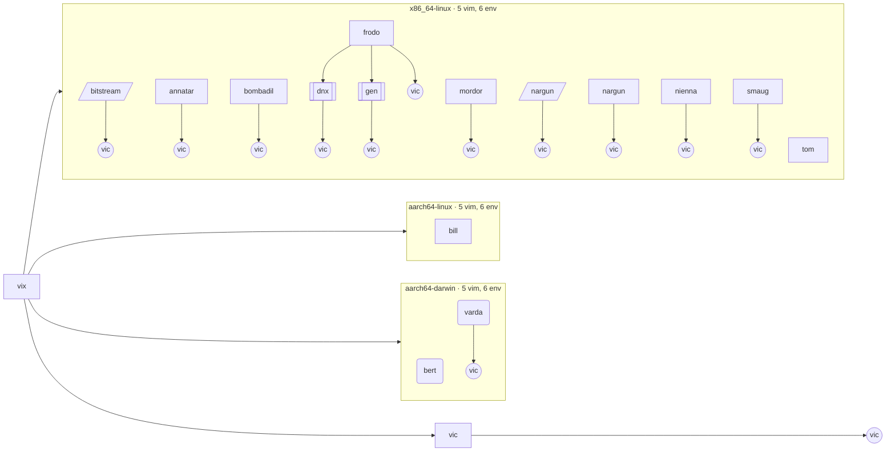

**Kind tree**: solid edges are `spawns`; dotted edges are fields that refer to another kind.

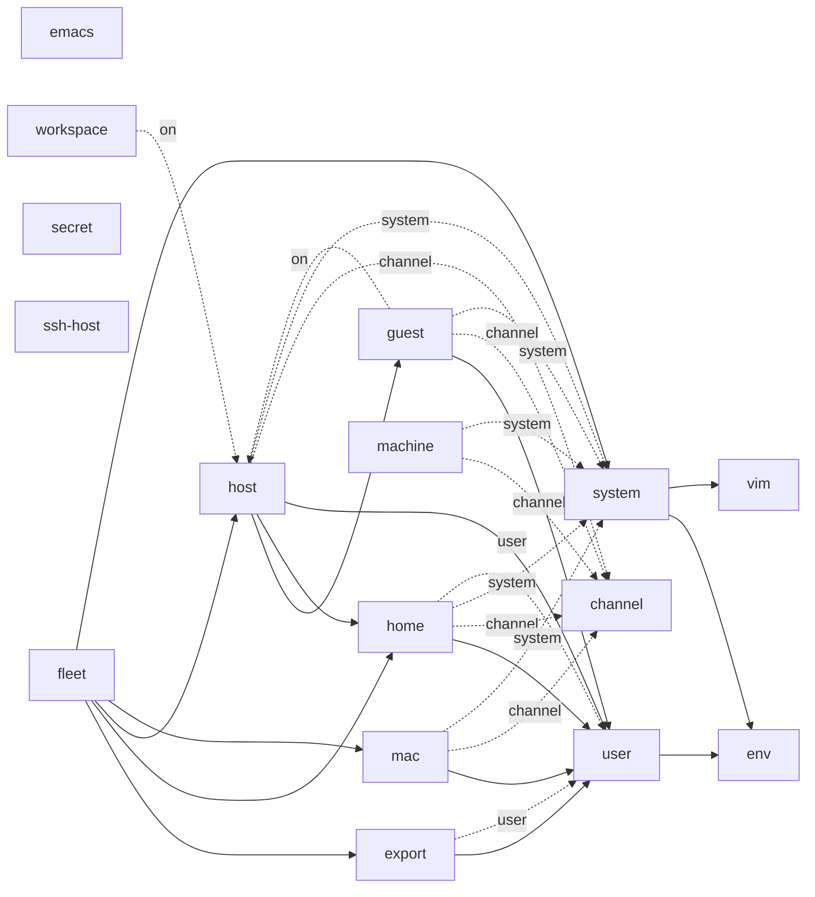

**Sink forwarding**: a dashed edge is a sink key that feeds another sink (label: the kind that declares it).
A solid edge is `out`, labelled with the receivers that build a flake output.

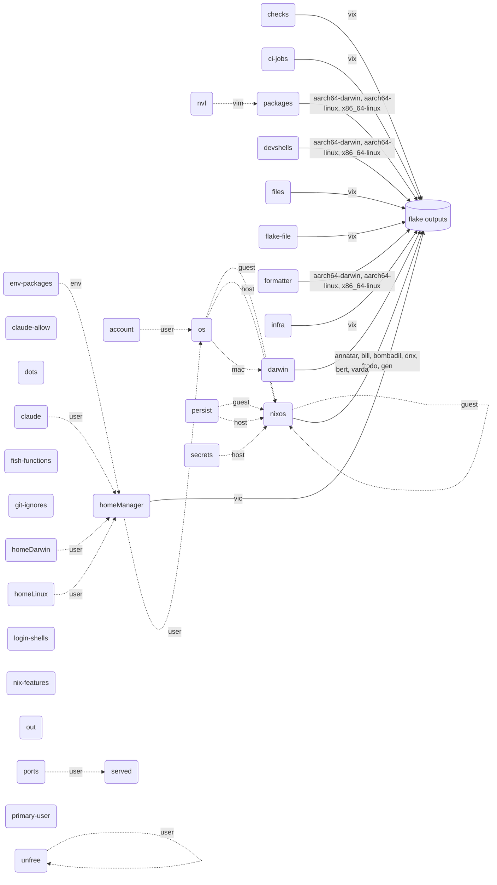

**Gates**: the aspects other aspects name in `at` (tiers and roles), and what each one's own `at` reads.
A dashed edge is under a `not`. The count is the aspects that name the gate.

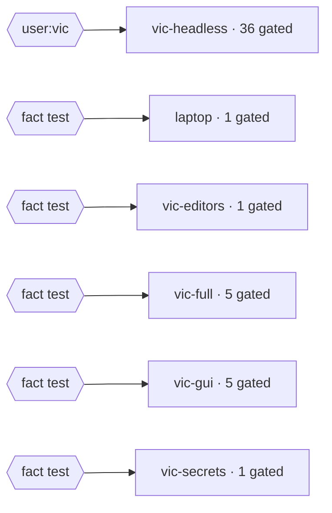

**Routing**: where aspect elements go, per sink. "Given by" counts the aspects that give to the sink;
"Received at" is the kind of the scope that reduces it (the nearest ancestor-or-self with the sink).

| Sink | Given by (aspects) | Received at | Elements |
|---|---|---|---|
| `homeManager` | 52 | export, user | 614 |
| `flake-file` | 29 | fleet | 222 |
| `nvf` | 42 | vim | 186 |
| `dots` | 10 | user | 108 |
| `nixos` | 30 | guest, host | 104 |
| `os` | 9 | guest, home, host, mac | 99 |
| `claude-allow` | 7 | user | 91 |
| `homeLinux` | 8 | user | 78 |
| `git-ignores` | 5 | user | 65 |
| `account` | 7 | user | 57 |
| `env-packages` | 6 | env | 36 |
| `unfree` | 7 | host, user, vim | 35 |
| `claude` | 2 | user | 26 |
| `ports` | 2 | user | 26 |
| `devshells` | 2 | system | 21 |
| `fish-functions` | 2 | user | 21 |
| `ci-jobs` | 4 | fleet | 19 |
| `secrets` | 2 | user | 18 |
| `packages` | 7 | system | 17 |
| `nix-features` | 1 | guest, host, mac | 13 |
| `login-shells` | 1 | guest, home, host, mac | 12 |
| `checks` | 6 | fleet | 11 |
| `darwin` | 6 | mac | 9 |
| `infra` | 1 | fleet | 9 |
| `out` | 2 | fleet | 4 |
| `formatter` | 1 | system | 3 |
| `files` | 2 | fleet | 2 |
| `homeDarwin` | 2 | user | 2 |
| `primary-user` | 2 | host, mac | 2 |
| `persist` | 1 | host | 1 |

<details><summary>Routing by kind: giving kind, sink, receiving kind (edge label: elements)</summary>

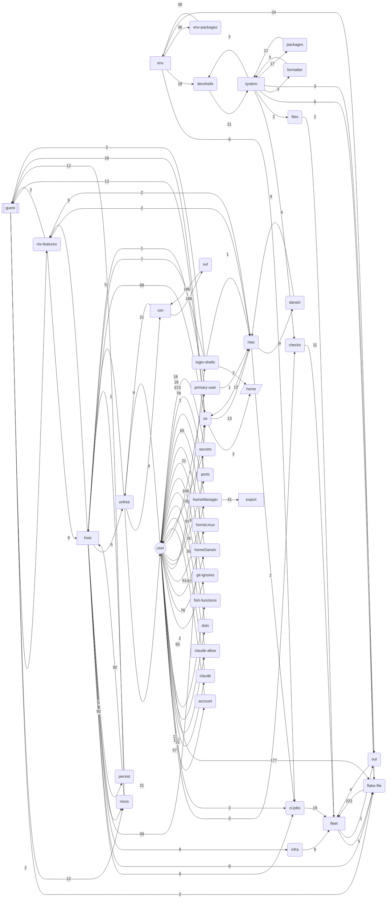

</details>

## Fleet data

<details><summary>Aspects by machine and home (an aspect that gave an element there or to a user below)</summary>

| aspect | bitstream | annatar | bill | bombadil | frodo | dnx | gen | mordor | nargun | nargun | nienna | smaug | tom | bert | varda |
| --- | --- | --- | --- | --- | --- | --- | --- | --- | --- | --- | --- | --- | --- | --- | --- |
| `account` | x | x |  | x | x | x | x | x | x | x | x | x |  |  | x |
| `admin` |  | x |  | x | x | x | x | x | x | x | x | x |  |  |  |
| `ai-agents` | x | x |  | x | x | x | x | x | x | x | x | x |  |  | x |
| `ai-ai` | x | x |  | x | x | x | x | x | x | x | x | x |  |  | x |
| `ai-browser-tools` |  | x |  | x | x |  |  | x | x | x | x | x |  |  | x |
| `ai-claude` | x | x |  | x | x | x | x | x | x | x | x | x |  |  | x |
| `ai-claude-allow` | x | x |  | x | x | x | x | x | x | x | x | x |  |  | x |
| `ai-claude-scripts` | x | x |  | x | x | x | x | x | x | x | x | x |  |  | x |
| `ai-claude-session-tools` | x | x |  | x | x | x | x | x | x | x | x | x |  |  | x |
| `ai-headroom` | x | x |  | x | x | x | x | x | x | x | x | x |  |  | x |
| `ai-herdr` | x | x |  | x | x | x | x | x | x | x | x | x |  |  | x |
| `ai-ircc` | x | x |  | x | x | x | x | x | x | x | x | x |  |  | x |
| `ai-lightjj` | x | x |  | x | x | x | x | x | x | x | x | x |  |  | x |
| `ai-mcp` | x | x |  | x | x | x | x | x | x | x | x | x |  |  | x |
| `ai-plugins` | x | x |  | x | x | x | x | x | x | x | x | x |  |  | x |
| `ai-skills` | x | x |  | x | x | x | x | x | x | x | x | x |  |  | x |
| `ai-statusline` | x | x |  | x | x | x | x | x | x | x | x | x |  |  | x |
| `ai-tools` | x | x |  | x | x | x | x | x | x | x | x | x |  |  | x |
| `ai-vic-agents` | x | x |  | x | x | x | x | x | x | x | x | x |  |  | x |
| `ai-vic-hooks` | x | x |  | x | x | x | x | x | x | x | x | x |  |  | x |
| `ai-vic-settings` | x | x |  | x | x | x | x | x | x | x | x | x |  |  | x |
| `ai-vic-tools` | x | x |  | x | x | x | x | x | x | x | x | x |  |  | x |
| `ai-vic-upstream` | x | x |  | x | x | x | x | x | x | x | x | x |  |  | x |
| `all-firmware` |  |  |  | x |  |  |  |  |  |  |  | x |  |  |  |
| `annatar-distro` |  | x |  |  |  |  |  |  |  |  |  |  |  |  |  |
| `autoinclude` |  |  |  |  | x |  |  | x | x |  | x | x |  |  |  |
| `bitstream` | x |  |  |  |  |  |  |  |  |  |  |  |  |  |  |
| `bootable` |  |  |  | x | x |  |  | x | x |  | x | x |  |  |  |
| `carapace` | x | x |  | x | x | x | x | x | x | x | x | x |  |  | x |
| `ci-home` | x |  |  |  |  |  |  |  | x | x |  |  |  |  |  |
| `ci-host` |  | x | x | x | x |  |  | x | x |  | x | x | x |  |  |
| `ci-mac` |  |  |  |  |  |  |  |  |  |  |  |  |  | x | x |
| `ci-runner` |  |  | x |  |  |  |  |  |  |  |  |  | x | x |  |
| `cli-tools` | x | x |  | x | x | x | x | x | x | x | x | x |  |  | x |
| `darwin-base` |  |  |  |  |  |  |  |  |  |  |  |  |  |  | x |
| `darwin-shells` |  |  |  |  |  |  |  |  |  |  |  |  |  | x | x |
| `darwin-state` |  |  |  |  |  |  |  |  |  |  |  |  |  | x | x |
| `dev-tools` | x | x |  |  | x | x | x | x | x | x | x | x |  |  | x |
| `direnv` | x | x |  | x | x | x | x | x | x | x | x | x |  |  | x |
| `direnv-host` |  | x |  | x | x | x | x | x | x |  | x | x |  |  | x |
| `enthium` |  |  |  |  |  |  |  |  | x |  |  |  |  |  |  |
| `fish` | x | x |  | x | x | x | x | x | x | x | x | x |  |  | x |
| `frodo-apps` |  |  |  |  | x |  |  |  |  |  |  |  |  |  |  |
| `frodo-base` |  |  |  |  | x |  |  |  |  |  |  |  |  |  |  |
| `frodo-desktop` |  |  |  |  | x |  |  |  |  |  |  |  |  |  |  |
| `frodo-impermanence` |  |  |  |  | x |  |  |  |  |  |  |  |  |  |  |
| `frodo-user` |  |  |  |  | x | x | x |  |  |  |  |  |  |  |  |
| `gh-dash` | x | x |  |  | x | x | x | x | x | x | x | x |  |  | x |
| `git` | x | x |  | x | x | x | x | x | x | x | x | x |  |  | x |
| `gitleaks` | x | x |  |  | x | x | x | x | x | x | x | x |  |  | x |
| `hk-clean` | x | x |  |  | x | x | x | x | x | x | x | x |  |  | x |
| `hm-darwin` |  |  |  |  |  |  |  |  |  |  |  |  |  |  | x |
| `hm-nixos` |  | x |  | x | x | x | x | x | x |  | x | x |  |  |  |
| `home-state` | x | x |  | x | x | x | x | x | x | x | x | x |  |  | x |
| `hostname` |  | x | x | x | x | x | x | x | x |  | x | x | x | x | x |
| `infra-facts` |  | x | x | x | x |  |  | x | x |  | x | x | x |  |  |
| `installer-base` |  |  |  | x |  |  |  |  |  |  |  |  |  |  |  |
| `installer-user` |  |  |  | x |  |  |  |  |  |  |  |  |  |  |  |
| `jujutsu` | x | x |  | x | x | x | x | x | x | x | x | x |  |  | x |
| `jujutsu-aliases` | x | x |  | x | x | x | x | x | x | x | x | x |  |  | x |
| `jujutsu-revsets` | x | x |  | x | x | x | x | x | x | x | x | x |  |  | x |
| `jujutsu-ui` | x | x |  | x | x | x | x | x | x | x | x | x |  |  | x |
| `kde-desktop` |  |  |  |  |  |  |  |  | x |  |  |  |  |  |  |
| `kvm-amd` |  |  |  |  | x |  |  | x | x |  |  |  |  |  |  |
| `kvm-intel` |  |  |  | x |  |  |  |  |  |  | x | x |  |  |  |
| `laptop` |  |  |  |  | x |  |  |  |  |  |  |  |  |  |  |
| `laptop-power` |  |  |  |  | x |  |  |  |  |  |  |  |  |  |  |
| `login-shell` | x | x |  | x | x | x | x | x | x | x | x | x |  |  | x |
| `login-shells` |  | x | x | x | x | x | x | x | x |  | x | x | x | x | x |
| `macos-keys` |  |  |  | x | x |  |  |  | x |  | x | x |  |  |  |
| `niri-desktop` |  |  |  |  | x |  |  |  | x |  |  |  |  |  |  |
| `nix-daemon-containment` |  | x | x | x | x |  |  | x | x |  | x | x | x |  |  |
| `nix-features` |  | x | x | x | x | x | x | x | x |  | x | x | x | x | x |
| `nix-features-base` |  | x | x | x | x | x | x | x | x |  | x | x | x | x | x |
| `nix-settings` |  | x |  | x | x |  |  | x | x |  | x | x |  |  | x |
| `nix-sweep` | x | x |  |  | x | x | x | x | x | x | x | x |  |  | x |
| `nix-tools` | x | x |  | x | x | x | x | x | x | x | x | x |  |  | x |
| `nix-tuning` |  | x | x | x | x | x | x | x | x |  | x | x | x | x | x |
| `nixos-account` |  | x |  | x | x | x | x | x | x | x | x | x |  |  |  |
| `nixos-state` |  | x | x | x | x | x | x | x | x |  | x | x | x |  |  |
| `no-gui-guest` |  |  |  |  | x | x | x |  |  |  |  |  |  |  |  |
| `no-gui-home` | x |  |  |  |  |  |  |  |  |  |  |  |  |  |  |
| `nvidia` |  |  |  |  |  |  |  | x |  |  |  | x |  |  |  |
| `primary-user` |  |  |  |  |  |  |  |  |  |  |  |  |  |  | x |
| `primary-user-darwin` |  |  |  |  |  |  |  |  |  |  |  |  |  | x | x |
| `sec-ops` |  | x |  |  | x |  |  | x | x | x | x | x |  |  | x |
| `sven-mcp-claude` | x | x |  | x | x | x | x | x | x | x | x | x |  |  | x |
| `sysctl` |  | x | x | x | x | x | x | x | x |  | x | x | x |  |  |
| `terminals` |  | x |  |  | x |  |  | x | x | x | x | x |  |  | x |
| `unfree` | x | x | x | x | x | x | x | x | x | x | x | x | x | x | x |
| `vic-browsers` |  | x |  |  | x |  |  | x | x | x | x | x |  |  | x |
| `vic-desktop-tools` |  | x |  | x | x |  |  | x | x | x | x | x |  |  | x |
| `vic-dots` | x | x |  | x | x | x | x | x | x | x | x | x |  |  | x |
| `vic-editors` |  | x |  |  | x |  |  | x | x | x | x | x |  |  | x |
| `vic-emacs` |  | x |  | x | x |  |  | x | x | x | x | x |  |  | x |
| `vic-fonts` |  | x |  | x | x | x | x | x | x | x | x | x |  |  | x |
| `vic-hm-backup` |  | x |  | x | x | x | x | x | x |  | x | x |  |  |  |
| `vic-niri` |  | x |  | x | x |  |  | x | x | x | x | x |  |  | x |
| `vic-nix-index` | x | x |  | x | x | x | x | x | x | x | x | x |  |  | x |
| `vic-nix-registry` | x | x |  | x | x | x | x | x | x | x | x | x |  |  | x |
| `vic-nvim` | x | x |  | x | x | x | x | x | x | x | x | x |  |  | x |
| `vic-nvim-gui` |  | x |  | x | x |  |  | x | x | x | x | x |  |  | x |
| `vic-secrets` |  | x |  | x | x |  |  | x | x | x | x | x |  |  | x |
| `vic-ssh` |  | x |  | x | x |  |  | x | x | x | x | x |  |  | x |
| `vic-system` | x | x |  | x | x | x | x | x | x | x | x | x |  |  |  |
| `vic-vscode-server` |  | x |  |  | x |  |  | x | x | x | x | x |  |  | x |
| `vm` |  |  |  |  | x | x | x |  |  |  |  |  |  |  |  |
| `vm-host` |  |  |  |  | x |  |  |  |  |  |  |  |  |  |  |
| `wl-broadcom` |  |  |  | x |  |  |  |  |  |  | x | x |  |  |  |
| `workspace-share` |  |  |  |  | x | x | x |  |  |  |  |  |  |  |  |
| `wsl` |  | x |  |  |  |  |  |  |  |  |  |  |  |  |  |
| `wsl-user` |  | x |  |  |  |  |  |  |  |  |  |  |  |  |  |
| `xfce-desktop` |  |  |  | x | x |  |  | x | x |  | x | x |  |  |  |

</details>

**Flake inputs by aspect** (the `flake-file` sink writes flake.nix from them):

| aspect | inputs |
| --- | --- |
| `ai-herdr` | `bun2nix`, `flake-parts`, `llm-agents`, `nix-systems`, `nixpkgs-lib`, `systems` |
| `ai-ircc` | `ircc` |
| `ai-lightjj` | `lightjj` |
| `ai-plugins` | `caveman`, `claude-plugins-official`, `diagram-design`, `mattpocock`, `ponytail`, `superpowers-extended-cc-marketplace`, `ui-ux-pro-max-skill` |
| `ai-skills` | `genie-agent`, `gstack`, `one-skill-to-rule-them-all`, `quipu` |
| `ai-vic-tools` | `flake-utils`, `notebooklm-pack`, `rust-overlay` |
| `ai-vic-upstream` | `deepwiki-skill`, `vercel-skills` |
| `autoinclude` | `disko` |
| `channel-inputs` | `darwin`, `home-manager`, `nixpkgs` |
| `devshell` | `devshell` |
| `edgevpn` | `edgevpn` |
| `emacs-inputs` | `doom-emacs` |
| `enthium` | `enthium` |
| `env-rust` | `rust-overlay` |
| `files-inputs` | `files` |
| `formatter` | `treefmt-nix` |
| `frodo-impermanence` | `impermanence` |
| `git` | `nix-wrapper-modules` |
| `jujutsu` | `flake-parts`, `jjui`, `nix-wrapper-modules`, `nixpkgs-lib` |
| `nix-tools` | `trix` |
| `vic-browsers` | `flake-utils`, `helium`, `nixpkgs-darwin` |
| `vic-editors` | `flake-parts`, `nixpkgs-lib`, `vscode-server` |
| `vic-emacs` | `SPC`, `bats-assert`, `bats-support`, `blueprint`, `systems` |
| `vic-nix-index` | `nix-index-database` |
| `vic-secrets` | `sops-nix` |
| `vim-inputs` | `mnw`, `nvf` |
| `vix-flake` | `flake-file`, `import-tree`, `sven` |
| `vm` | `microvm` |
| `wsl` | `nixos-wsl` |

**CI jobs by runner** (`nix eval --json .#ci.matrix`; ci.yml also runs one job per `checks.<sys>.<name>`):

| runner | system | jobs | may fail |
| --- | --- | --- | --- |
| `macos-latest` | `aarch64-darwin` | `bert`, `varda` | `varda` |
| `ubuntu-24.04-arm` | `aarch64-linux` | `bill` |  |
| `ubuntu-latest` | `x86_64-linux` | `annatar`, `bombadil`, `devshell-fullenv-x86_64-linux`, `devshell-goenv-x86_64-linux`, `devshell-nixenv-x86_64-linux`, `devshell-nodeenv-x86_64-linux`, `devshell-pyenv-x86_64-linux`, `devshell-rustenv-x86_64-linux`, `frodo`, `mordor`, `nargun`, `nienna`, `smaug`, `tom`, `vic@bitstream`, `vic@nargun` |  |

**ssh hosts and jumps** (`sven.ssh-host`, by Host match name). Jump cycles: none.

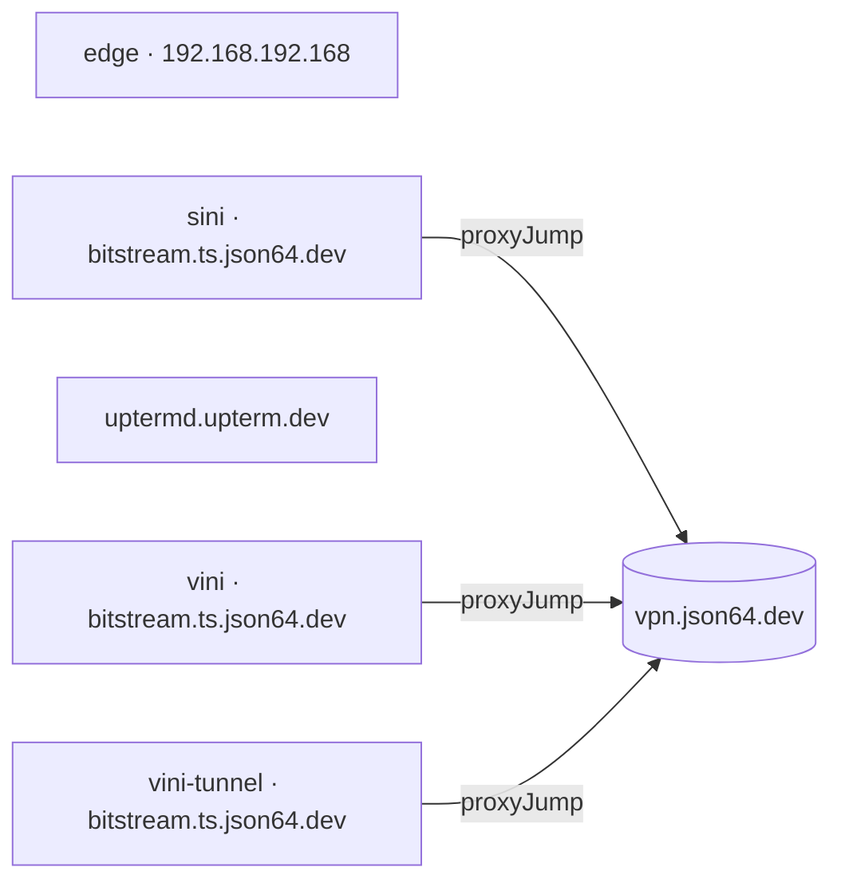

**Ports per scope** (the `ports` sink; `ask "portsOf"`, `ask "freePort"`). Declared, routed nowhere: `vic-vini-dashboards`, `vix-rdesk`.

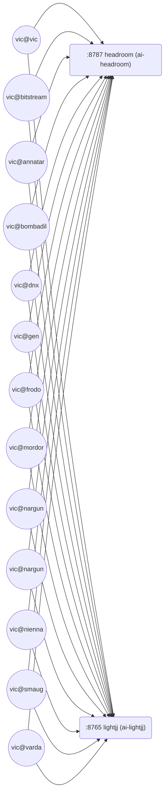

**CI runners per system**: the runner label of a system comes from the one machine on it with `ghRunner`
(0 or 2+ is an error record); a dashed edge is a machine whose job may fail (`ciBroken`).

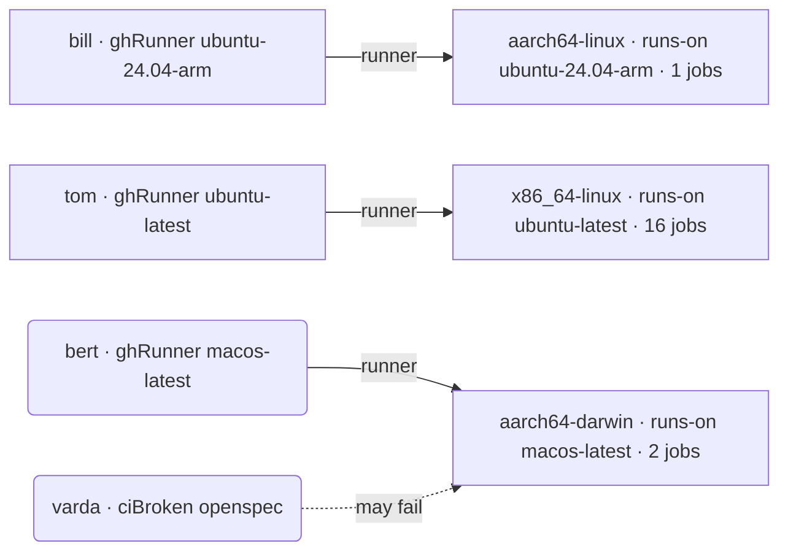

<details><summary>Flake input follows (26 of 54 inputs follow another)</summary>

Follows targets flake.nix does not declare (the follows-declared invariant): none.

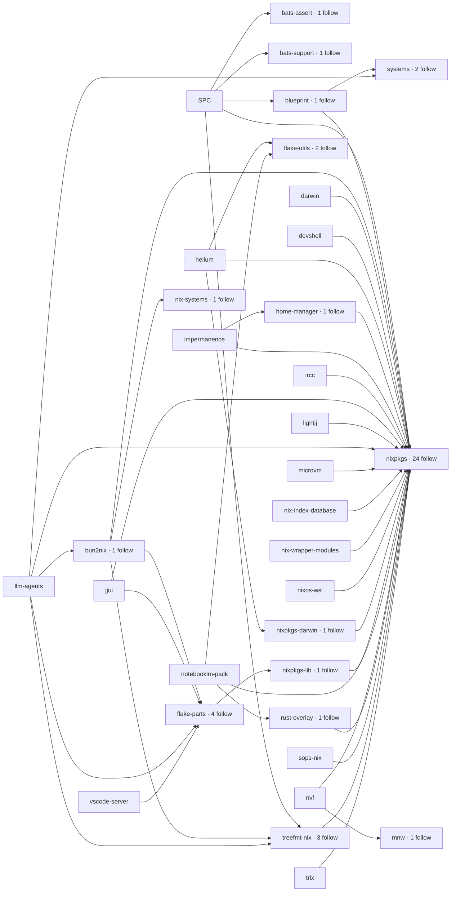

</details>

**Secrets plan**: sops file (dotted), secret, the aspect that gives it, the machine or home it lands on.
Declared and deployable, but given by no aspect: none.

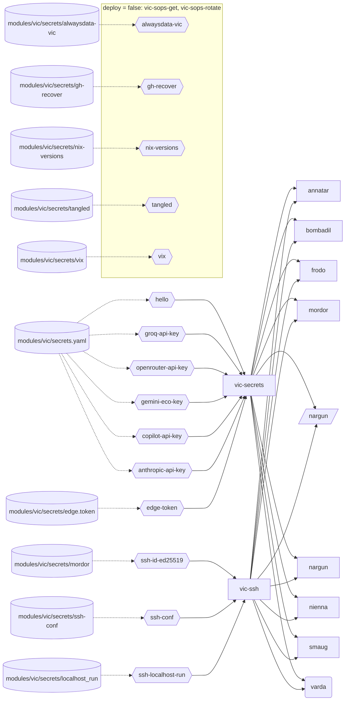

<details><summary>vim profiles by feature, envs by lang and package, dotfiles</summary>

| feature | astrovim | lazyvim | neovim | nvim | vscode-vim |
| --- | --- | --- | --- | --- | --- |
| theme | `astrodark` | `tokyonight` | `catppuccin-frappe` | `base24-rebecca` |  |
| gui, aliases | gui | gui | gui | gui vi vim |  |
| `avante` | x |  |  |  |  |
| `blink` | x | x |  | x |  |
| `bufferline` | x |  |  |  |  |
| `codecompanion` | x |  |  | x |  |
| `conform` |  | x |  |  |  |
| `copilot` |  | x |  |  |  |
| `copilot-chat` |  |  |  | x |  |
| `dropbar` | x |  |  |  |  |
| `flash` |  | x |  |  |  |
| `globals` |  |  | x |  |  |
| `go` | x |  |  |  |  |
| `grug-far` |  | x |  |  |  |
| `haunt` |  |  |  | x |  |
| `hunk` |  |  |  | x |  |
| `jj` |  |  | x | x |  |
| `lazy` |  |  | x |  |  |
| `lsp` | x | x |  | x |  |
| `lua` | x |  |  |  |  |
| `lualine` | x |  |  |  |  |
| `mini` |  |  | x |  |  |
| `mini-essentials` |  | x |  |  |  |
| `mini-files` |  |  |  | x |  |
| `moonbit` |  |  |  | x |  |
| `neo-tree` | x |  |  |  |  |
| `noice` |  | x |  |  |  |
| `nvim-lint` |  | x |  |  |  |
| `persistence` |  | x |  |  |  |
| `rust` | x | x |  | x |  |
| `scope` | x |  |  |  |  |
| `smartcolumn` | x |  |  |  |  |
| `snacks` |  |  | x | x |  |
| `snacks-extras` |  |  |  | x |  |
| `snacks-header` |  |  | x |  |  |
| `snacks-keys` |  |  | x | x |  |
| `todo-comments` |  | x |  |  |  |
| `toggleterm` | x |  |  |  |  |
| `trouble` |  | x |  |  |  |
| `tv` |  |  | x |  |  |
| `tv-vim` |  |  |  | x |  |
| `which-key` | x | x | x | x |  |

| env | langs | aspects | packages |
| --- | --- | --- | --- |
| `fullenv` | `c`, `go`, `nix`, `node`, `python`, `rust` | `env-c`, `env-go`, `env-nix`, `env-node`, `env-python`, `env-rust` | `bun`, `cachix`, `deadnix`, `gcc-wrapper`, `gnumake`, `go`, `gopls`, `just`, `nh`, `nil`, `nix-unit`, `nixd`, `nixfmt`, `nodejs`, `npins`, `pkg-config-wrapper`, `pnpm`, `python3`, `rust-default`, `statix`, `typescript`, `uv`, `wasm-bindgen-cli`, `wasm-pack`, `yarn` |
| `goenv` | `go` | `env-go` | `go`, `gopls` |
| `nixenv` | `nix` | `env-nix` | `cachix`, `deadnix`, `just`, `nh`, `nil`, `nix-unit`, `nixd`, `nixfmt`, `npins`, `statix` |
| `nodeenv` | `node` | `env-node` | `bun`, `nodejs`, `pnpm`, `typescript`, `yarn` |
| `pyenv` | `python` | `env-python` | `python3`, `uv` |
| `rustenv` | `c`, `rust` | `env-c`, `env-rust` | `gcc-wrapper`, `gnumake`, `pkg-config-wrapper`, `rust-default`, `wasm-bindgen-cli`, `wasm-pack` |

| home path | modules/vic/dots/ | aspect |
| --- | --- | --- |
| `.claude/skills/vic-lessons` | `claude/skills/vic-lessons` | `ai-vic-hooks` |
| `.config/bottom` | `config/bottom` | `cli-tools` |
| `.config/btop` | `config/btop` | `cli-tools` |
| `.config/gh/config.yml` | `config/gh/config.yml` | `git` |
| `.config/jjui` | `config/jjui` | `jujutsu` |
| `.config/ghostty` | `config/ghostty` | `terminals` |
| `.config/wezterm` | `config/wezterm` | `terminals` |
| `.config/autostart/lxqt-config-touchpad-autostart.desktop` | `config/autostart/lxqt-config-touchpad-autostart.desktop` | `vic-desktop-tools` |
| `.config/fontconfig` | `config/fontconfig` | `vic-desktop-tools` |
| `.config/rtk` | `config/rtk` | `vic-dots` |
| `.config/doom` | `config/doom` | `vic-emacs` |
| `.config/niri` | `config/niri` | `vic-niri` |
| `.config/noctalia` | `config/noctalia` | `vic-niri` |

</details>

## Counts

66 scopes, 16 kinds, 204 aspects, 2053 routed elements.
A kind with 0 scopes is data: nothing spawns it.

| Kind | Fields | Spawns | Sinks | Scopes |
|---|---|---|---|---|
| `channel` | `darwin`, `home-manager`, `nixpkgs` |  |  | 0 |
| `emacs` | `bins`, `bootstrap`, `configDots`, `daemon`, `fish`, `initDir`, `wrapper` |  |  | 0 |
| `env` | `langs` |  | `env-packages` | 18 |
| `export` | `user` | `user` | `homeManager` | 1 |
| `fleet` |  | `export`, `home`, `host`, `mac`, `system` | `checks`, `ci-jobs`, `files`, `flake-file`, `infra`, `out`, `served` | 1 |
| `guest` | `addr`, `channel`, `checkout`, `ciBroken`, `cpu`, `desktops`, `envs`, `firmware`, `form`, `ghRunner`, `gpu`, `impermanence`, `keyboard`, `layouts`, `macAddress`, `on`, `sharedPkgs`, `system`, `trimmedModules`, `users`, `wifi`, `workspace`, `workstation` | `user` | `login-shells`, `nix-features`, `nixos`, `os`, `persist`, `ports`, `unfree` | 2 |
| `home` | `channel`, `checkout`, `ciBroken`, `envs`, `ghRunner`, `on`, `system`, `user` | `user` | `login-shells`, `nix-features`, `nixos`, `os`, `persist`, `ports`, `primary-user`, `secrets`, `unfree` | 2 |
| `host` | `channel`, `checkout`, `ciBroken`, `cpu`, `desktops`, `envs`, `firmware`, `form`, `ghRunner`, `gpu`, `impermanence`, `keyboard`, `layouts`, `sharedPkgs`, `system`, `trimmedModules`, `users`, `wifi`, `workstation` | `guest`, `home`, `user` | `login-shells`, `nix-features`, `nixos`, `os`, `persist`, `ports`, `primary-user`, `secrets`, `unfree` | 9 |
| `mac` | `channel`, `checkout`, `ciBroken`, `cpu`, `desktops`, `envs`, `firmware`, `form`, `ghRunner`, `gpu`, `impermanence`, `keyboard`, `layouts`, `sharedPkgs`, `system`, `trimmedModules`, `users`, `wifi`, `workstation` | `user` | `darwin`, `login-shells`, `nix-features`, `os`, `ports`, `primary-user`, `unfree` | 2 |
| `machine` | `channel`, `checkout`, `ciBroken`, `cpu`, `desktops`, `envs`, `firmware`, `form`, `ghRunner`, `gpu`, `impermanence`, `keyboard`, `layouts`, `sharedPkgs`, `system`, `trimmedModules`, `users`, `wifi`, `workstation` |  |  | 0 |
| `secret` | `deploy`, `format`, `path`, `sopsFile`, `sopsKey` |  |  | 0 |
| `ssh-host` | `controlPersist`, `extraOptions`, `forwardAgent`, `forwardsServedBy`, `host`, `hostname`, `localForwards`, `proxyJump`, `remoteForwards`, `serverAliveCountMax`, `serverAliveInterval`, `setEnv`, `user` |  |  | 0 |
| `system` | `darwin`, `legacyPackages`, `runner` | `env`, `vim` | `devshells`, `formatter`, `packages` | 3 |
| `user` | `admin`, `email`, `fullName`, `shell` | `env` | `account`, `claude`, `claude-allow`, `dots`, `fish-functions`, `git-ignores`, `homeDarwin`, `homeLinux`, `homeManager`, `ports`, `secrets`, `unfree` | 13 |
| `vim` | `aliases`, `features`, `gui`, `theme` |  | `nvf`, `unfree` | 15 |
| `workspace` | `on`, `repo` |  |  | 0 |

| Sink | Given at | Received at | Elements |
|---|---|---|---|
| `account` | `user` | `user` | 57 |
| `checks` | `system`, `user` | `fleet` | 11 |
| `ci-jobs` | `env`, `host`, `mac`, `user` | `fleet` | 19 |
| `claude` | `user` | `user` | 26 |
| `claude-allow` | `user` | `user` | 91 |
| `darwin` | `mac` | `mac` | 11 |
| `devshells` | `env`, `system` | `system` | 21 |
| `dots` | `user` | `user` | 108 |
| `env-packages` | `env` | `env` | 36 |
| `files` | `system` | `fleet` | 2 |
| `fish-functions` | `user` | `user` | 21 |
| `flake-file` | `env`, `fleet`, `guest`, `host`, `system`, `user` | `fleet` | 222 |
| `formatter` | `system` | `system` | 3 |
| `git-ignores` | `user` | `user` | 65 |
| `homeDarwin` | `user` | `user` | 2 |
| `homeLinux` | `user` | `user` | 78 |
| `homeManager` | `user` | `export`, `user` | 639 |
| `infra` | `host` | `fleet` | 9 |
| `login-shells` | `user` | `guest`, `home`, `host`, `mac` | 12 |
| `nix-features` | `guest`, `host`, `mac` | `guest`, `host`, `mac` | 13 |
| `nixos` | `guest`, `host` | `guest`, `host` | 118 |
| `nvf` | `vim` | `vim` | 186 |
| `os` | `guest`, `host`, `mac`, `user` | `guest`, `home`, `host`, `mac` | 122 |
| `out` | `export`, `fleet`, `host`, `mac`, `system`, `user` | `fleet` | 42 |
| `packages` | `system`, `vim` | `system` | 32 |
| `persist` | `host` | `host` | 1 |
| `ports` | `user` | `user` | 26 |
| `primary-user` | `user` | `host`, `mac` | 2 |
| `secrets` | `user` | `user` | 18 |
| `served` | `user` | `fleet` | 13 |
| `unfree` | `host`, `user`, `vim` | `guest`, `home`, `host`, `mac`, `user`, `vim` | 47 |

## Capability index

**Invariants** (`sven.invariants`, Datalog over the fleet's facts). The result is a query on the eval result, not
readable inside the fleet: `nix eval --impure --json --file query.nix check.violations` (`[ ]` when every one holds).

| Invariant | File |
|---|---|
| `follows-declared` | `modules/agent/invariants.nix` |
| `gui-needs-graphical` | `modules/agent/invariants.nix` |
| `runners-no-users` | `modules/agent/invariants.nix` |
| `secrets-need-trusted` | `modules/agent/invariants.nix` |
| `unique-guest-addr` | `modules/agent/invariants.nix` |
| `unique-local-forward` | `modules/agent/invariants.nix` |
| `unique-port` | `modules/agent/invariants.nix` |

**Stored queries** (`r.ask name args`, or the MCP tool `sven_ask`):

| Query | Required | Optional | File |
|---|---|---|---|
| `aspectsOn` | `name` |  | `modules/agent/queries.nix` |
| `featuresOf` | `vim` |  | `modules/agent/queries.nix` |
| `freePort` | `name` |  | `modules/agent/synthesis.nix` |
| `inputsOf` | `aspect` |  | `modules/agent/queries.nix` |
| `portsOf` | `name` |  | `modules/agent/queries.nix` |
| `unfreeOn` | `name` |  | `modules/agent/queries.nix` |
| `whoInstalls` | `pkg` |  | `modules/agent/queries.nix` |

**MCP tools** (14, `mcp/sven-mcp.sh`): `sven_ask`, `sven_check`, `sven_context`, `sven_declared_in`, `sven_errors`, `sven_explain`, `sven_export`, `sven_impact`, `sven_labels`, `sven_program`, `sven_queries`, `sven_schema`, `sven_stage`, `sven_why_not`.

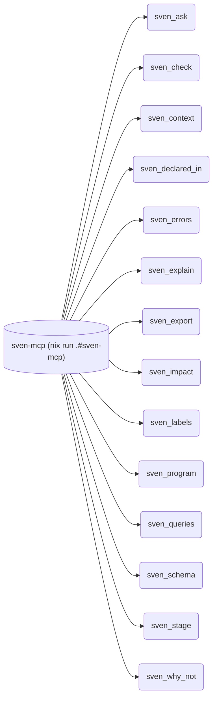

**Trust labels** (`sven.labels`, by file path prefix). An agent edits under a low-trust prefix;
`(import ./query.nix).floor 3` lists every element its aspects route.

| Prefix | Trust | Aspects |
|---|---|---|
| `agent/` | 1 | 3: `mcp-app`, `rdf-pack`, `sven-mcp-claude` |
| `modules/` | 3 | 180 |
| `vic/ai/` | 2 | 21 |

**Knowledge pack** (`out.rdfPack`, [agent/rdf.nix](modules/agent/rdf.nix)): the sha256 and count of the routing graph
as sorted N-Triples (the same in every file order), and SHACL shapes from the schema: `nix eval --json .#rdfPack.sha256`.

**Queries on an eval result** (`r = import ./query.nix`): `active`, `ask`, `check`, `context`, `data`, `declaredIn`, `errors`, `explain`, `facts`, `flake`, `floor`, `graph`, `impact`, `labels`, `queries`, `reduced`, `root`, `schema`, `scopes`, `undefined`.

**Engine library** (`sven.lib`): `agent`, `allowed`, `asOf`, `derive`, `diffData`, `eval`, `grant`, `history`, `is`, `jsonSafe`, `maybe`, `mkFlake`, `narrow`, `opt`, `stage`, `validAt`, `without`.
Reduce strategies: `entries`, `list`, `merge`, `one`, `set`. Change programs (`sven.lib.program`): `dryRun`, `opErrors`, `render`, `toModule`, `validate`.
Graphs (`sven.lib.graphs`): `cycles`, `fromEdges`, `layers`, `nodesOf`, `paths`, `reach`, `reachers`, `sccs`, `shortest`, `topo`, `transpose`, `uniq'`.

**The cycle form** (`cycle = { tree, ... }: …`): `vm-host`.

<details><summary>Vocabulary: kinds, sinks, tiers, roles</summary>

### Kinds: one scope per instance when some `spawns` reaches the kind

| kind | what it is | instances (`sven.<kind>.<name>`) |
| --- | --- | --- |
| `channel` | data: the nixpkgs, home-manager and nix-darwin pins a machine builds with | unstable |
| `emacs` | data: an emacs distribution | doom, spc |
| `env` | a dev environment: langs become a devshell and user packages | fullenv, goenv, nixenv, nodeenv, pyenv, rustenv |
| `export` | a user outside any machine: its home content becomes `homeModules.<name>` | vic |
| `fleet` | root scope; it spawns every system, host, mac and home | vix |
| `guest` | a microvm on a host: its nixos goes into the host's `microvm.vms` | dnx, gen |
| `home` | a home-manager home of one user: standalone, or on a host (`on`) behind walls | bitstream, nargun |
| `host` | a NixOS machine: `nixosConfigurations.<host>` | annatar, bill, bombadil, frodo, mordor, nargun, nienna, smaug, tom |
| `mac` | a nix-darwin machine: `darwinConfigurations.<mac>` | bert, varda |
| `machine` | data: typed facts (cpu, form, desktops, users, envs) hosts, guests and macs copy | - (abstract) |
| `secret` | data: a sops secret a feature asks for | alwaysdata-vic, anthropic-api-key, copilot-api-key, edge-token, gemini-eco-key, gh-recover, groq-api-key, hello, nix-versions, openrouter-api-key, ssh-conf, ssh-id-ed25519, ssh-localhost-run, tangled, vix |
| `ssh-host` | data: one ssh client matchBlock | edge, sini, uptermd.upterm.dev, vini, vini-tunnel |
| `system` | a nix system; it spawns one scope per vim profile and per env | aarch64-darwin, aarch64-linux, x86_64-linux |
| `user` | a person: full name, email, login shell, admin | vic |
| `vim` | a neovim profile: a feature list built per system into one nvf package (+ a gui wrapper) | astrovim, lazyvim, neovim, nvim, vscode-vim |
| `workspace` | data: a project an isolated guest works on (repo path) | dnx, gen |

### Sinks: where an aspect key sends its element

An element goes to the nearest ancestor-or-self scope that has the sink. A sink key that names another sink forwards the reduced value to it.

| sink | on | reduce | forwards to | what |
| --- | --- | --- | --- | --- |
| `env-packages` | `env` | `list` | `homeManager` | tools of an env's langs: its devshell, and the home of a user whose machine lists it |
| `homeManager` | `export`, `user` | `list` | `os`, `out` | a home-manager module: on a machine, or `homeConfigurations."<user>@<place>"` |
| `checks` | `fleet` | `merge` | `out` | `checks.<sys>.<name>`: fmt, README, flake.nix, no-gui, config tests |
| `ci-jobs` | `fleet` | `merge` | `out` | one GitHub build job per buildable host, mac, home and linux devshell |
| `files` | `fleet` | `list` | `out` | repo files (this README, ci.yml) built by sini/files |
| `flake-file` | `fleet` | `merge` | `out` | this flake.nix: the inputs each aspect uses |
| `infra` | `fleet` | `merge` | `out` | fleet: facts per host from its data; `checks.x86_64-linux.infra-<host>` compares them with the built system |
| `out` | `fleet` | `merge` |  | flake outputs |
| `served` | `fleet` | `entries` |  | fleet: every user's ports with the scope that serves them (`entries`); ssh tunnels forward from it |
| `login-shells` | `guest`, `home`, `host`, `mac` | `list`, `set` |  | login shells of the users; the machine enables `programs.<shell>` |
| `nix-features` | `guest`, `home`, `host`, `mac` | `flat`, `list` |  | each machine's `nix.settings.experimental-features` |
| `nixos` | `guest`, `home`, `host` | `list` | `nixos`, `out` | a NixOS module |
| `os` | `guest`, `home`, `host`, `mac` | `list` | `darwin`, `nixos` | a module for either OS |
| `persist` | `guest`, `home`, `host` | `list`, `persist` | `nixos` | paths impermanence keeps on the host |
| `ports` | `guest`, `home`, `host`, `mac`, `user` | `entries`, `list` | `served` | `{ port; what; }` a machine's or a user's service listens on: for unique-port, portsOf and freePort; a user's go up to `served` |
| `unfree` | `guest`, `home`, `host`, `mac`, `user`, `vim` | `list`, `merge` | `unfree` | unfree package names the machine, home or vim profile allows |
| `primary-user` | `home`, `host`, `mac` | `list`, `one` |  | the one admin user name a mac (system.primaryUser) or a wsl host (wsl.defaultUser) reads; two admins are an error record |
| `secrets` | `home`, `host`, `user` | `flat`, `list` | `nixos` | secret refs: on a user, `vic-secrets` gives them to sops-nix in home-manager; on a host, to sops-nix in NixOS |
| `darwin` | `mac` | `list` | `out` | a nix-darwin module |
| `devshells` | `system` | `merge` | `out` | `devShells.<sys>`: one per env, and the maintainer shell |
| `formatter` | `system` | `one` | `out` | `formatter.<sys>` (treefmt, `nix fmt`); reduce `one`: a second formatter is an error record |
| `packages` | `system` | `merge` | `out` | `packages.<sys>`: own packages, vim profiles, write-files |
| `account` | `user` | `list` | `os` | `users.users.<user>` on the user's machine |
| `claude` | `user` | `layers` | `homeManager` | Claude Code settings.json layers `{ rank; set; }`: a higher rank wins per key, equal ranks must agree |
| `claude-allow` | `user` | `sorted` |  | Claude Code permissions; `ai-claude` reads them |
| `dots` | `user` | `merge` |  | `{ "<home path>" = "<dots path>"; }`; `vic-dots` links them into $HOME |
| `fish-functions` | `user` | `merge` |  | fish functions; `fish` writes them once |
| `git-ignores` | `user` | `flat` |  | global git ignores; `git` reads them |
| `homeDarwin` | `user` | `list` | `homeManager` | homeManager on darwin only |
| `homeLinux` | `user` | `list` | `homeManager` | homeManager on linux only |
| `nvf` | `vim` | `list` | `packages` | an nvf module of a vim profile |

### vic profiles: tiers gate features (`at = sven.aspects.vic-<tier>`); roles come from facts or host files

| name | active |
| --- | --- |
| `vic-full` | not on iso images (not within `installer`) |
| `vic-gui` | `on-graphical`: every gui program lives here |
| `vic-headless` | everywhere vic lives: terminal tools only (homes, guests, servers) |
| `vic-secrets` | `on-trusted`; also the sops consumer |
| role `ci-runner` | machines with a `ghRunner` label (from data): bare GitHub runners, no users |
| role `graphical` | hosts with desktops or wsl, workstation macs (from facts); a host file can add itself |
| role `installer` | iso hosts (from facts) |
| role `on-darwin` | a user on a mac or darwin home (`homeDarwin`) |
| role `on-graphical` | a user within `graphical`, no non-graphical guest between |
| role `on-linux` | a user on a linux machine or home (`homeLinux`) |
| role `on-trusted` | a user within `trusted`, no untrusted guest between |
| role `trusted` | a host file adds itself: holds vic's secrets |

204 aspects live under `modules/`; `sven.aspects.<name>` each.
Active nowhere (empty `at`, or a marker no scope matches): `frodo-wipe-root`, `frodo-wipe-user`, `gnome-desktop`, `laptop-thermald`, `shared-pkgs-no-docs`, `vic-rdesk`, `vic-vini-dashboards`, `vix-rdesk`.

</details>

<details><summary>Directory structure</summary>

import-tree loads every `.nix` file under `modules/`. Paths with `/_` are skipped (data files, payload).
Dir names are for humans only. sven does not read them.

| dir | purpose |
| --- | --- |
| `modules/agent/` | invariants, stored queries, krn synthesis, trust labels, the rdf pack and the MCP app for agents |
| `modules/checks/` | flake checks over the built configs: platform packages, no gui on headless homes |
| `modules/desktops/` | desktop sessions (gnome, kde, niri, xfce), remote desktop, darwin defaults |
| `modules/docs/` | this README: tour, graphs, vocabulary, recipes, open decisions |
| `modules/editors/` | the vim and emacs kinds |
| `modules/envs/` | the env kind, vic's envs, and one aspect per language |
| `modules/flake/` | flake plumbing: flake-file, files, outputs, ci, formatter, devshell |
| `modules/forms/` | aspects that key on the machine form: iso, wsl, laptop, laptop power |
| `modules/hardware/` | aspects that key on machine facts: cpu, gpu, wifi, keyboard, firmware |
| `modules/hosts/` | NixOS hosts, macs and standalone homes: facts, roles, own aspects; hosts/<name>/_nixos is autoincluded |
| `modules/nix/` | nix settings, daemon, experimental features, unfree, state version |
| `modules/packages/` | own packages and scripts |
| `modules/platforms/` | how hosts, guests, macs and homes build, and their sinks: accounts, impermanence, ports |
| `modules/roles/` | roles and vic's feature tiers |
| `modules/topology/` | the scope tree and its data: fleet, systems, channels, machines, users, workspaces, secrets, ssh hosts |
| `modules/vic/` | vic's own features, by area (below) |

Inside `modules/vic/`:

| dir | purpose |
| --- | --- |
| `modules/vic/ai/` | claude, agents, mcp servers, skills |
| `modules/vic/dev/` | dev tools and security ops |
| `modules/vic/dots/` | dotfiles linked into $HOME |
| `modules/vic/edit/` | browsers, editors and terminals |
| `modules/vic/nvf/` | neovim features, one file each, and the vim profiles |
| `modules/vic/secrets/` | sops-encrypted files (opaque) |
| `modules/vic/shell/` | fish and shell tools |
| `modules/vic/sys/` | fonts, ssh, secrets and system bits |
| `modules/vic/vcs/` | git and jujutsu |

</details>

<details><summary>Recipes: add a host, feature, env, ssh host, secret, port</summary>

**Add a host**: facts only; hardware and desktop aspects key on them (`modules/hosts/<name>.nix`).
Hardware files in `modules/hosts/<name>/_nixos/` load by autoinclude; `ghRunner = "<label>";` makes the host a bare CI runner.
```nix
sven.host.elrond = {
  system = sven.system.x86_64-linux;
  users = [ sven.user.vic ];
  workstation = true;
  cpu = "amd";
  desktops = [ "kde" "niri" ];
};
sven.aspects.trusted.at = sven.host.elrond;
```
The same host as a change program an agent can dry-run (errors, invariant violations, diff) before it writes a file.
Users stay in the host file: a program value is not a list of refs.
```sh
echo '{"jsonrpc":"2.0","id":1,"method":"tools/call","params":{"name":"sven_program","arguments":{"program":[{"fields":{"cpu":"amd","system":{"ref":{"kind":"system","name":"x86_64-linux"}},"workstation":true},"kind":"host","name":"elrond","op":"new"},{"op":"set","path":["host","elrond","desktops"],"value":["kde","niri"]},{"aspect":"trusted","kind":"host","name":"elrond","op":"place"}]}}}' | nix run .#sven-mcp
```

**Add a user feature**: one aspect, gated by a tier (`modules/vic/<area>/<name>.nix`).
```nix
sven.aspects.dev-tools = {
  at = sven.aspects.vic-full;
  homeManager = { pkgs, ... }: { home.packages = [ pkgs.gh pkgs.jq ]; };
};
```

**Add a dev env**: an instance, then list it on a machine or home (`envs = [ sven.env.goenv ];`).
```nix
sven.env.goenv.langs = [ "go" ];
sven.aspects.env-go = {
  at = sven.helpers.envHas "go";
  env-packages = { env, ... }: [ env.system.legacyPackages.go ];
};
```

**Add an ssh host**: one instance becomes one `programs.ssh` matchBlock (`modules/topology/ssh-hosts.nix`).
```nix
sven.ssh-host.edge = {
  host = "edge";
  hostname = "192.168.192.168";
};
```

**Add a secret**: declare it, then give it from the feature that reads it (a user's or a host's `secrets` sink).
A file in `modules/vic/secrets/` that no instance owns is an error record; `deploy = false` keeps a file off every machine.
```nix
sven.secret.groq-api-key.sopsKey = "groq_api_key"; # modules/topology/secrets.nix
sven.aspects.my-feature.secrets = [ sven.secret.groq-api-key ];
```

**Add a port**: ask for a free one, then give it on the `ports` sink next to the setting that reads it.
A second service on the same port of one machine is a unique-port violation.
```nix
# (import ./query.nix).ask "freePort" { name = "frodo"; }   =>   { port = 8000; used = [ ... ]; }
sven.aspects.my-service = {
  at = sven.aspects.vic-headless;
  ports = [ { port = 8000; what = "my-service"; } ];
};
```

</details>

## Decisions open

Each one changes a setting, a structure or an output, so it waits for vic.

- secret rotation dates: `validTo` and `reviewDate` on secrets give warnings when a date passes (vic sets the dates)
- variants (one machine, two builds): no vix machine has a second build today; bombadil is an image, annatar is WSL only
- shared pkgs and trimmed modules on: each host needs its drvPath oracle, and a module list for the current nixpkgs

<details><summary>History</summary>

- [sven (current)](https://github.com/vic/vix/tree/sven): Ren rewritten in sven; Ren classes and channels are sinks
- [Ren](https://github.com/vic/vix/tree/ren)
- [Den without flakes](https://github.com/vic/vix/tree/historic/den)
- [Den with flakes + flake-parts](https://github.com/vic/vix/tree/historic/den-flake-parts)
- [Dendritic flake-parts only](https://github.com/vic/vix/tree/historic/dendritic-flake-parts)
- [blueprint](https://github.com/vic/vix/tree/historic/blueprint)
- [flake-parts](https://github.com/vic/vix/tree/historic/flake-parts)
- [old m1 flake](https://github.com/vic/vix/tree/historic/mk-darwin-system) with [mk-darwin-system](https://github.com/vic/mk-darwin-system)
- other with snowfall-lib lost

</details>
