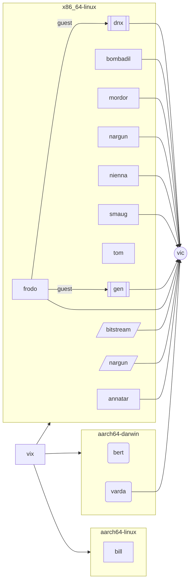
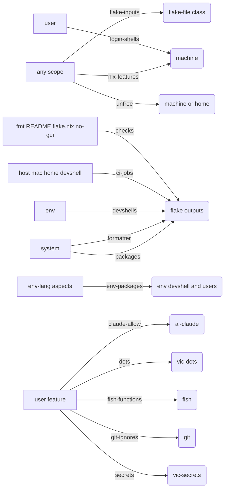
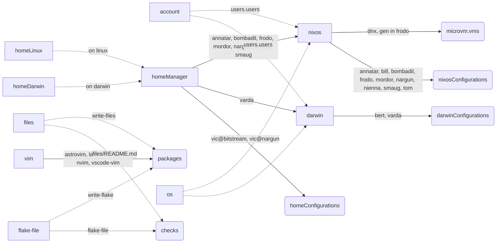

# vix

Vic's machines, homes and dev envs in [Ren](https://github.com/vic/ren) (built on [Gen](https://github.com/sini/gen)), a re-take on [Den](https://github.com/denful/den).
Generated file: edit `modules/docs/`, then run `nix run .#write-files`.

## A tour

| Ren | in vix |
| --- | --- |
| `ren.kinds.<k>` | typed data: [`host`](modules/platforms/nixos.nix#L43), [`home`](modules/platforms/home-manager.nix#L26), [`user`](modules/topology/people.nix#L12), [`env`](modules/envs/env.nix#L15) |
| `ren.<k>.<name>` | an instance: [`ren.host.frodo`](modules/hosts/frodo.nix#L25), [`ren.user.vic`](modules/people/vic.nix#L21), [`ren.env.rustenv`](modules/envs/envs.nix#L5) |
| `below`, `spawns` | the scope tree: [`host → user`](modules/platforms/nixos.nix#L45), [`host → guest`](modules/platforms/microvm.nix#L16), [`system → vim`](modules/editors/vim.nix#L21) |
| `is` | subkinds: [`a host is a machine`](modules/platforms/nixos.nix#L44), [`a guest is a host`](modules/platforms/microvm.nix#L20) |
| `ren.aspects.<a>` | one feature: [`git`](modules/vic/vcs/git.nix#L10), [`kvm-amd`](modules/community/kvm-amd.nix#L4), [`vic-gui`](modules/people/vic.nix#L8) |
| `at` | where an aspect is on: [`at = ren.aspects.vic-headless`](modules/vic/shell/fish.nix#L11) |
| `includes`, `excludes` | add or drop aspects below a scope: [`frodo includes its hardware`](modules/hosts/frodo.nix#L44), [`its guests exclude it`](modules/hosts/frodo-guests.nix#L38) |
| `ren.classes.<c>` | a module system an aspect key feeds: [`nixos`](modules/platforms/nixos.nix#L49), [`vim`](modules/editors/vim.nix#L43) |
| `into` | how a class builds: [`nixosConfigurations.<host>`](modules/platforms/nixos.nix#L53) |
| `ren.channels.<c>` | data a feature emits for a receiver: [`git-ignores`](modules/vic/vcs/git.nix#L5), [`checks`](modules/features/checks.nix#L4) |
| `fold`, `to` | how a channel merges, and who reads it: [`checks folds attrs into the fleet`](modules/features/checks.nix#L5) |
| `and`, `anyOf`, `not`, `within`, `has`, `when` | predicates for `at` and `to`: [`when (s: s.host.cpu == "amd")`](modules/community/kvm-amd.nix#L7) |
| `same` | identity: [`a guest runs on the host it names in on`](modules/platforms/microvm.nix#L12) |

## Commands

```sh
nix build .#nixosConfigurations.frodo.config.system.build.toplevel
nix build '.#homeConfigurations."vic@bitstream".activationPackage'
nix run .#write-files                 # regenerate this README
nix flake check                       # includes checks.x86_64-linux."files/README.md"
nix eval --json .#ci.matrix           # every CI build job: host, mac, home, devshell
```

## Fleet map

Generated from live Ren instances (`ren.host`, `ren.mac`, `ren.guest`, `ren.home`). JSON: `nix build .#fleet-ir`.

Scope tree: `[host]` `(mac)` `[[guest]]` `[/home/]` `((user))`, grouped by system. Each machine spawns its own `vic` scope; drawn once.



<details><summary>Channels and class forwarding (diagrams)</summary>

**Channels**: emitter to receiver, one edge per `ren.channels` name.



**Class forwarding**: solid edges carry live instance names, dashed edges are static.



</details>

<details><summary>Vocabulary: kinds, classes, channels, profiles</summary>

### Kinds: one scope per instance when some `below` lists the kind

| kind | what it is | instances (`ren.<kind>.<name>`) |
| --- | --- | --- |
| `channel` | the nixpkgs, home-manager and nix-darwin pins a machine builds with | unstable |
| `emacs` | an emacs distribution (data only, no scopes) | doom, spc |
| `env` | a dev environment: langs become a devshell and user packages | fullenv, goenv, nixenv, nodeenv, pyenv, rustenv |
| `fleet` | root scope; everything lives below it | vix |
| `guest` | a microvm on a host (is host): its own nixos and users, built inside the host | dnx, gen |
| `home` | a standalone home-manager home of one user | bitstream, nargun |
| `host` | a NixOS machine (is machine) | annatar, bill, bombadil, frodo, mordor, nargun, nienna, smaug, tom |
| `mac` | a nix-darwin machine (is machine) | bert, varda |
| `machine` | abstract: typed facts (cpu, form, desktops, users, envs) hosts and macs share | - (abstract) |
| `secret` | a sops secret a feature asks for | anthropic-api-key, copilot-api-key, edge-token, gemini-eco-key, groq-api-key, hello, openrouter-api-key, ssh-conf, ssh-id-ed25519, ssh-localhost-run |
| `ssh-host` | one ssh client matchBlock | edge, sini, uptermd.upterm.dev, vini, vini-tunnel |
| `system` | a nix system; machines, homes and envs are built for one | aarch64-darwin, aarch64-linux, x86_64-linux |
| `user` | a person: full name, email, login shell, admin | vic |
| `vim` | a neovim profile: a feature list built per system into one nvf package (+ a gui wrapper) | astrovim, lazyvim, neovim, nvim, vscode-vim |
| `workspace` | a project an isolated claude guest works on (data): repo path; one guest each | dnx, gen |

### Classes: module systems an aspect key names

| class | builds |
| --- | --- |
| `account` | `users.users.<user>` on the user's machine |
| `darwin` | `darwinConfigurations.<mac>` |
| `files` | repo files (this README): `packages.write-files` + `checks` |
| `flake-file` | this flake.nix from `flake-inputs`: `packages.write-flake` + `checks.<sys>.flake-file` |
| `homeDarwin` | homeManager on darwin only |
| `homeLinux` | homeManager on linux only |
| `homeManager` | a user's home: on a host, on a mac, or `homeConfigurations.<user>@<home>` |
| `nixos` | `nixosConfigurations.<host>` |
| `os` | either OS: forwards to nixos or darwin |
| `vim` | nvf: one neovim per vim profile, emitted as packages.<profile> |

### Channels: data an aspect key emits and a receiver folds

| channel | emitted by | received by |
| --- | --- | --- |
| `checks` | formatter (fmt), files (README), flake-file (flake.nix), no-gui (headless homes and guests) | flake `checks.<sys>.<name>` |
| `ci-jobs` | every buildable host, mac, home and linux devshell | flake `ci.matrix`: one GitHub build job each |
| `claude-allow` | user features | `ai-claude` settings.json permissions |
| `devshells` | the `devshell` aspect, per env | flake `devShells.<sys>` |
| `dots` | user features: `{ "<home path>" = "<dots path>"; }` | `vic-dots`: links into $HOME |
| `env-packages` | `env-<lang>` aspects | the env's devshell, and users whose machine lists the env |
| `fish-functions` | user features | `fish` writes them once |
| `flake-inputs` | any aspect: the inputs it uses | forwarded into the `flake-file` class (x86_64-linux) |
| `formatter` | each system (treefmt) | flake `formatter.<sys>` (`nix fmt`) |
| `git-ignores` | user features | `git` global ignores |
| `login-shells` | users with a shell | their machine enables `programs.<shell>` |
| `nix-features` | any scope (base: nix-command flakes on every machine) | each machine's `nix.settings.experimental-features` |
| `packages` | aspects at a system | flake `packages.<sys>`, read back as `(vix.perSystem pkgs inputs.self).packages` |
| `secrets` | user features: `[ ren.secret.x ]` | `vic-secrets`: sops-nix config |
| `unfree` | any scope: `vix.allowUnfree [ … ]` | the machine or home's `allowUnfreePredicate` |

### vic profiles: tiers gate features (`at = ren.aspects.vic-<tier>`); roles are included or derived

| name | active |
| --- | --- |
| `vic-full` | not on iso images (not within `installer`) |
| `vic-gui` | `on-graphical`: every gui program lives here |
| `vic-headless` | everywhere vic lives: terminal tools only (homes, guests, servers) |
| `vic-secrets` | `on-trusted`; also the sops consumer |
| role `graphical` | hosts with desktops or wsl, workstation macs (from facts) |
| role `installer` | iso hosts (from facts) |
| role `metal` | a nixos host that is not a guest: builds `nixosConfigurations` |
| role `on-darwin` | a user on a mac or darwin home (`homeDarwin`) |
| role `on-graphical` | a user within `graphical`, no non-graphical guest between |
| role `on-linux` | a user on a linux machine or home (`homeLinux`) |
| role `on-trusted` | a user within `trusted`, no untrusted guest between |
| role `trusted` | included by a machine: holds vic's secrets |

206 aspects live under `modules/`; `ren.aspects.<name>` each.

</details>

<details><summary>Directory structure</summary>

import-tree loads every `.nix` file under `modules/`. Paths with `/_` are skipped.
Dir names are for humans only. Ren does not read them.

| dir | purpose |
| --- | --- |
| `modules/community/` | shared hardware and desktop aspects; they key on machine facts |
| `modules/docs/` | this README: generators, vocabulary, recipes |
| `modules/editors/` | vim profiles (nvf) and emacs distributions |
| `modules/envs/` | dev environments and one aspect per language |
| `modules/features/` | flake plumbing: ci, checks, formatter, packages, unfree, accounts |
| `modules/homes/` | standalone home-manager homes |
| `modules/hosts/` | NixOS and darwin machines, and frodo's guests |
| `modules/net/` | ssh hosts and remote desktop |
| `modules/packages/` | own packages and scripts |
| `modules/people/` | users, and the vic-* feature tier aspects |
| `modules/platforms/` | channels (nixpkgs pins) and how machines are built |
| `modules/security/` | secrets declared as data |
| `modules/topology/` | kinds and the scope tree: fleet, machines, users |
| `modules/vic/` | vic's own features, by area (below) |

Inside `modules/vic/`:

| dir | purpose |
| --- | --- |
| `modules/vic/ai/` | claude, agents, mcp servers, skills |
| `modules/vic/dev/` | dev tools and security ops |
| `modules/vic/dots/` | dotfiles linked into $HOME |
| `modules/vic/edit/` | browsers, editors and terminals |
| `modules/vic/nvf/` | neovim features, one file each |
| `modules/vic/secrets/` | sops setup for vic's secrets |
| `modules/vic/shell/` | fish and shell tools |
| `modules/vic/sys/` | fonts, ssh and system bits |
| `modules/vic/vcs/` | git and jujutsu |

</details>

<details><summary>Recipes: add a host, feature, env, ssh host, secret</summary>

**Add a host**: facts only; community aspects key on them (`modules/hosts/<name>.nix`).
```nix
ren.host.nargun = {
  system = ren.system.x86_64-linux;
  users = [ ren.user.vic ];
  workstation = true;
  cpu = "amd";
  desktops = [ "kde" "niri" ];
};
```

**Add a user feature**: one aspect, gated by a tier (`modules/vic/<area>/<name>.nix`).
```nix
ren.aspects.dev-tools = {
  at = ren.aspects.vic-full;
  homeManager = { pkgs, ... }: { home.packages = [ pkgs.gh pkgs.jq ]; };
};
```

**Add a dev env**: an instance, then list it on a machine or home (`envs = [ ren.env.goenv ];`).
```nix
ren.env.goenv.langs = [ "go" ];
ren.aspects.env-go = {
  at = ren.lib.and [ ren.kinds.env (ren.lib.when (s: builtins.elem "go" s.env.langs)) ];
  env-packages = { system, ... }: [ system.legacyPackages.go ];
};
```

**Add an ssh host**: one instance becomes one `programs.ssh` matchBlock (`modules/net/ssh-host.nix`).
```nix
ren.ssh-host.edge = {
  host = "edge";
  hostname = "192.168.192.168";
};
```

**Add a secret**: declare it, then emit it from the feature that reads it.
```nix
ren.secret.groq-api-key.sopsKey = "groq_api_key";  # modules/security/secret.nix
ren.aspects.my-feature.secrets = { ... }: [ ren.secret.groq-api-key ];
```

</details>

<details><summary>History</summary>

- [Ren (current)](https://github.com/vic/vix/tree/ren)
- [Den without flakes](https://github.com/vic/vix/tree/historic/den)
- [Den with flakes + flake-parts](https://github.com/vic/vix/tree/historic/den-flake-parts)
- [Dendritic flake-parts only](https://github.com/vic/vix/tree/historic/dendritic-flake-parts)
- [blueprint](https://github.com/vic/vix/tree/historic/blueprint)
- [flake-parts](https://github.com/vic/vix/tree/historic/flake-parts)
- [old m1 flake](https://github.com/vic/vix/tree/historic/mk-darwin-system) with [mk-darwin-system](https://github.com/vic/mk-darwin-system)
- other with snowfall-lib lost

</details>
